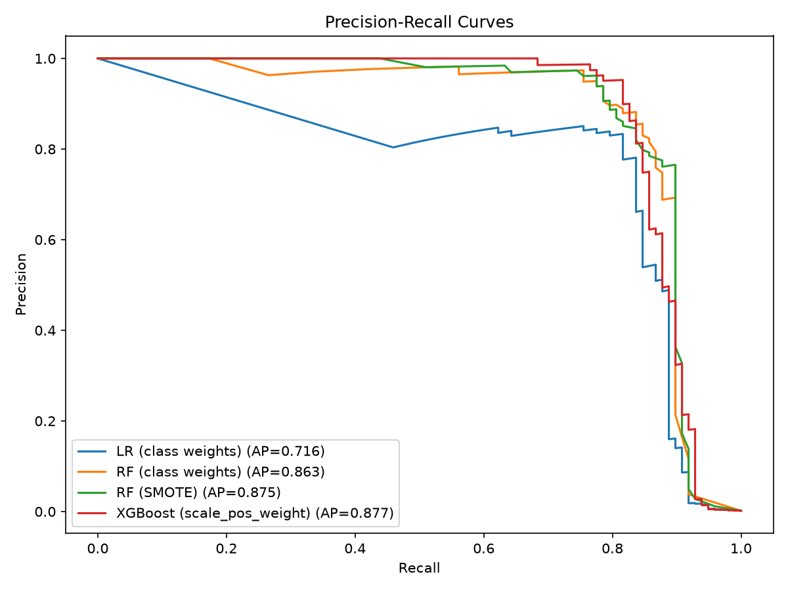
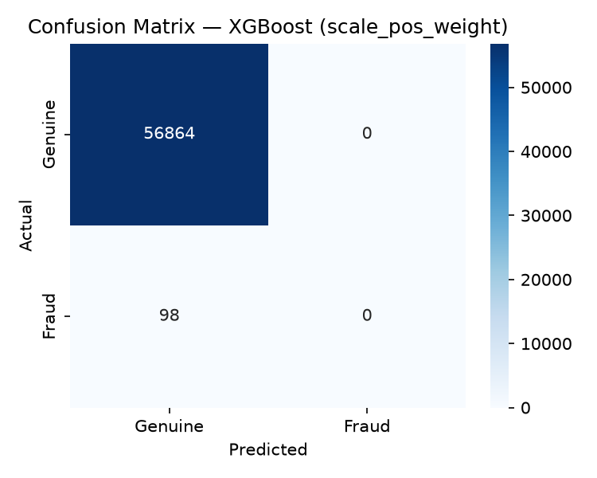
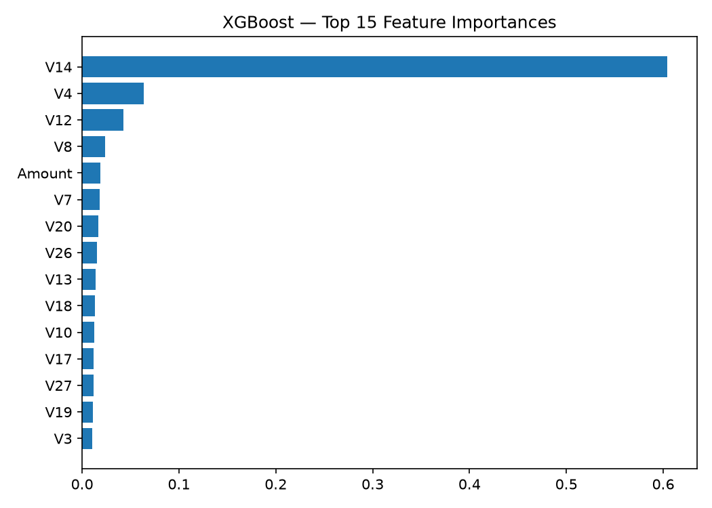

# Credit Card Fraud Detection

A machine learning project that detects fraudulent credit card transactions from a highly imbalanced dataset. Evaluated with precision, recall, and PR-AUC — not accuracy.

> **Status:** Complete
> **Author:** Puja Hansitha · B.Tech CSE (2029)

---

## Table of Contents

1. [Problem Statement](#problem-statement)
2. [Dataset](#dataset)
3. [Approach](#approach)
4. [Project Structure](#project-structure)
5. [Setup and Installation](#setup-and-installation)
6. [Usage](#usage)
7. [Results](#results)
8. [Key Learnings](#key-learnings)
9. [Limitations](#limitations)
10. [Future Work](#future-work)
11. [Tech Stack](#tech-stack)

---

## Problem Statement

Fraudulent transactions are rare (~0.17% of all transactions). This creates two problems:

- A model that labels everything "genuine" gets 99.8% accuracy while catching zero fraud.
- Missing a fraud (false negative) and wrongly blocking a genuine customer (false positive) have very different costs.

**Goal:** catch as much fraud as possible while keeping false alarms manageable, evaluated with PR-AUC.

---

## Dataset

- **Source:** [Credit Card Fraud Detection — Kaggle (ULB)](https://www.kaggle.com/datasets/mlg-ulb/creditcardfraud)
- **Size:** 284,807 transactions by European cardholders over two days in September 2013
- **Fraud cases:** 492 (0.172%)

| Column | Description |
|---|---|
| `Time` | Seconds elapsed since the first transaction |
| `V1`–`V28` | Anonymized PCA features |
| `Amount` | Transaction amount |
| `Class` | Target: `1` = fraud, `0` = genuine |

**Download:** place `creditcard.csv` in the `data/` folder. Not committed due to file size.

---

## Approach

### 1. EDA
- Class distribution, missing values, duplicates
- `Amount` and `Time` distributions for fraud vs. genuine
- Feature correlations with the target

### 2. Preprocessing
- Scaled `Amount` and `Time` (V features are already PCA-transformed)
- Stratified train/test split to preserve fraud ratio
- Resampling applied **only to training data** to prevent data leakage

### 3. Handling Class Imbalance
| Strategy | Applied to |
|---|---|
| `class_weight="balanced"` | Logistic Regression (baseline), Random Forest |
| SMOTE oversampling | Random Forest |
| `scale_pos_weight` | XGBoost |

### 4. Models
- Logistic Regression (baseline)
- Random Forest
- XGBoost

### 5. Evaluation
- Precision, Recall, F1
- **PR-AUC** (primary metric)
- ROC-AUC
- Confusion matrix

### 6. Threshold Tuning
Default 0.5 threshold is suboptimal for fraud. The F1-maximizing threshold is selected per model from the precision-recall curve.

---

## Project Structure

```
credit-card-fraud-detection/
├── data/
│   └── creditcard.csv          # download from Kaggle (not included)
├── notebooks/
│   ├── 01_eda.ipynb
│   └── 02_modeling.ipynb
├── src/
│   ├── preprocess.py           # loading, scaling, splitting
│   ├── train.py                # model training
│   └── evaluate.py             # metrics and plots
├── models/                     # saved .pkl files (git-ignored)
├── reports/
│   └── figures/                # generated charts
├── requirements.txt
└── README.md
```

---

## Setup and Installation

**Prerequisites:** Python 3.9+

```bash
git clone https://github.com/puja-hansitha/credit-card-fraud-detection.git
cd credit-card-fraud-detection

python -m venv venv
source venv/bin/activate        # Windows: venv\Scripts\activate

pip install -r requirements.txt
# Then place creditcard.csv in data/
```

---

## Usage

**Notebooks:**
```bash
jupyter notebook
# Open notebooks/01_eda.ipynb, then 02_modeling.ipynb
```

**Scripts:**
```bash
python src/train.py
python src/evaluate.py
```

---

## Results

| Model | Strategy | Threshold | Precision | Recall | F1 | PR-AUC | ROC-AUC |
|---|---|---|---|---|---|---|---|
| Logistic Regression | Class weights | 1.000 | 0.833 | 0.816 | 0.825 | 0.719 | 0.972 |
| Random Forest | Class weights | 0.390 | 0.882 | 0.837 | 0.859 | 0.863 | 0.957 |
| Random Forest | SMOTE | 0.770 | 0.962 | 0.776 | 0.859 | 0.875 | 0.973 |
| XGBoost | scale_pos_weight | 0.977 | 0.952 | 0.816 | 0.879 | **0.877** | 0.972 |

**Best model:** XGBoost (`scale_pos_weight`) — highest PR-AUC (0.877), Precision 0.952, Recall 0.816, F1 0.879.





---

## Key Learnings

- Accuracy is a misleading metric on imbalanced data; PR-AUC captures the precision/recall trade-off correctly.
- Resampling must happen after the train/test split and only on training data — doing it before leaks information into the test set.
- The decision threshold should be tuned per use case; the F1-maximizing threshold is a reasonable default but a real system would weigh the cost of missed fraud vs. false alarms.

---

## Limitations

- `V1`–`V28` are anonymized, so results can't be interpreted in business terms.
- Data covers two days from one region — patterns may not generalize.
- No cost-sensitive analysis using transaction `Amount` in the loss.
- Results are from a single train/test split, not cross-validation.
- Fraud patterns drift over time; a production system would need continuous retraining.

---

## Future Work

- Stratified k-fold cross-validation for more stable estimates
- Cost-sensitive learning using transaction `Amount`
- Anomaly detection comparison (Isolation Forest, Autoencoder)
- SHAP for model explainability
- Time-based train/test split to simulate real deployment
- Streamlit app for scoring a batch of transactions

---

## Tech Stack

Python · pandas · NumPy · scikit-learn · imbalanced-learn · XGBoost · Matplotlib · Seaborn · Jupyter

---

## Acknowledgements

Dataset: Worldline and the Machine Learning Group of ULB (Université Libre de Bruxelles), hosted on Kaggle.

## Contact

Puja Hansitha · [GitHub](https://github.com/puja-hansitha)
